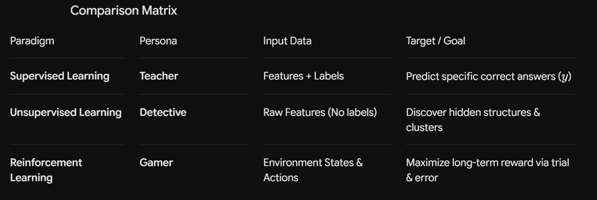
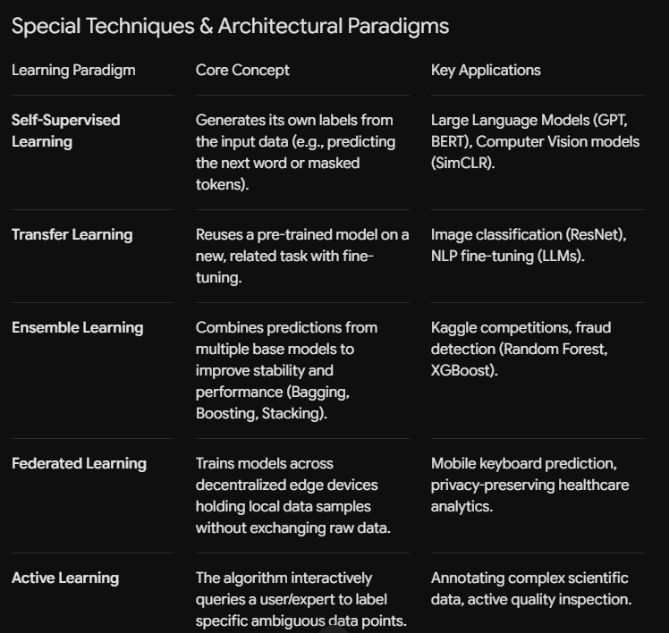

# Data Science

## Primary Learning Paradigms

1. Supervised Learning (TEACHER)
2. UnSupervised Learning (DETECTIVE)
3. Deep Learning (BRAIN)
4. Reinforcement Learning (PLAYER)


### 1. Supervised Learning $\rightarrow$ The "Teacher" Analogy

In Supervised Learning, the algorithm functions like a student sitting in a classroom with a Teacher who holds an answer key.

- **How it works:** The model receives input data paired with the correct ground-truth labels (like practice problems alongside their solutions). The student makes a prediction, the teacher points out the error, and the student adjusts until they consistently give correct answers.
- **Real-world Example:** Spam Detection.
    - **Training:** The model is fed thousands of emails, each pre-labeled by a "teacher" (human) as "Spam" or "Not Spam".
    - **Learning:** The model maps features (e.g., words like "free money", unknown sender) to the correct label.
    - **Outcome:** When a new, unseen email arrives, it accurately predicts whether it is spam.


### 2. Unsupervised Learning $\rightarrow$ The "Detective" Analogy

In Unsupervised Learning, there is no teacher or answer key. The model acts like a Detective arriving at a crime scene full of unorganized clues.   

- **How it works:** The detective examines raw, unlabeled data to discover hidden connections, underlying patterns, or natural groupings without being told what to look for.
- **Real-world Example:** Customer Segmentation for E-commerce.
    - **Investigation:** A store has raw transaction data for 100,000 shoppers without any categories attached.
    - **Clustering:** The "detective" model groups shoppers based on purchasing habits:
        - Group A: High-budget tech buyers.
        - Group B: Bargain-hunting weekend shoppers.
        - Group C: Late-night book readers.
    - **Outcome:** The store uses these discovered groups to run targeted marketing campaigns.


### 3. Reinforcement Learning $\rightarrow$ The "Gamer / Player" Analogy

In Reinforcement Learning, the model operates like a Video Game Player navigating an unfamiliar world.

- **How it works:** There are no labeled examples or predefined answers. Instead, an Agent (the player) interacts with an Environment (the game), taking actions through trial and error. Good moves yield a Reward ($+10$ points), while bad moves yield a Penalty (game over). The player learns a strategy to maximize their overall score over time.
- **Real-world Example:** Self-Driving Cars or Game-Playing AI.
    - **The Game:** Driving down a road.
    - **Actions:** Accelerate, steer left, steer right, brake.
    - **Feedback:** Staying in the lane yields small positive rewards ($+1$), reaching the destination yields a massive reward ($+1000$), and hitting a barrier results in a heavy penalty ($-1000$).
    - **Outcome:** Through millions of simulated drives, the AI learns to drive safely to maximize its cumulative reward




---

## Supervised Learning

Models train on labeled data, where each input features a corresponding target output ($y = f(x)$).

**Classification:** Predicts discrete class labels or categories.
Algorithms:
- Logistic Regression
- Decision Trees
- Random Forest
- Support Vector Machines (SVM)
- Naive Bayes.

Use Cases: Spam detection, disease diagnosis, sentiment analysis.

**Regression:** Predicts continuous numerical values.
Algorithms:
- Linear Regression
- Ridge/Lasso
- Decision Trees
- Gradient Boosting (XGBoost).

Use Cases: House price prediction, stock forecasting, sales projections.

**Flow Diagram:**

```
RAW DATA
   ↓
X = Customer Features
   ↓
y = Revenue
   ↓
Train/Test Split
   ↓
Preprocessing
   ↓
Logistic Regression
   ↓
Training
   ↓
Prediction
   ↓
Probability
   ↓
Accuracy / Precision / Recall / F1
```

Here are the four techniques for improving your logistic regression model, explained in English:

#### 1. Hyperparameter Tuning

Logistic regression has a parameter called C, which controls regularization strength — essentially how much the model is penalized for having large coefficients. A smaller C means stronger regularization (simpler model, less overfitting risk); a larger C means weaker regularization (model fits training data more closely, but risks overfitting).

Use GridSearchCV or RandomizedSearchCV to test multiple values of C (and optionally penalty type — l1, l2, elasticnet) and pick whichever combination performs best on cross-validated data, rather than guessing.

```
from sklearn.model_selection import GridSearchCV

param_grid = {
    'classifier__C': [0.01, 0.1, 1, 10, 100],
    'classifier__penalty': ['l1', 'l2'],
    'classifier__solver': ['liblinear']
}

grid_search = GridSearchCV(
    model_balanced, param_grid, cv=5, scoring='f1', n_jobs=-1
)
grid_search.fit(X_train, y_train)
print("Best params:", grid_search.best_params_)
```

#### 2. Feature Engineering

Creating new, more meaningful features from your existing columns, rather than relying only on the raw data as given. For your dataset, this could mean combining ProductRelated and ProductRelated_Duration into an average-time-per-page-view ratio, or creating interaction terms between related columns. Well-engineered features often help a simple model like logistic regression more than any amount of tuning, because it can't learn complex feature interactions on its own the way tree-based models can.


#### 3. Checking Multicollinearity

When two or more input features are highly correlated with each other, it distorts the model's coefficients and makes them unstable and hard to interpret (though it usually doesn't hurt raw predictive accuracy much). Check this using VIF (Variance Inflation Factor) — a VIF above 5-10 for a feature signals a problem worth addressing, typically by dropping one of the correlated columns.

```
from statsmodels.stats.outliers_influence import variance_inflation_factor

vif_data = pd.DataFrame()
vif_data["feature"] = numerical_features
vif_data["VIF"] = [
    variance_inflation_factor(X_train[numerical_features].values, i)
    for i in range(len(numerical_features))
]
print(vif_data)
```

#### 4. Feature Selection

Removing weak or irrelevant features entirely, rather than engineering new ones. This makes the model simpler, faster, and often more stable/interpretable. Common approaches: RFE (Recursive Feature Elimination), or simply looking at the model's coefficients and dropping features with near-zero weight.

```
from sklearn.feature_selection import RFE

rfe = RFE(estimator=LogisticRegression(max_iter=1000), n_features_to_select=10)
```

> :bulb: **Tip:** Remember to know about all the parameters of different **models** so that you can use those parameters to more finely control the behaviour of model so that you can get the fine tuned results as much as a cleaner way. Also learn about different graphs that can be used to determine some values needed by some paramaters in the models eg. AUC,ROC,PUC graphs

> :memo: **Note:** Cross-validation = a way to evaluate how stable your model's performance is (you've already got this)

> :memo: **Note:** The four techniques above = ways to actually improve the model itself (C tuning, better features, removing redundant/correlated features, dropping weak features)

